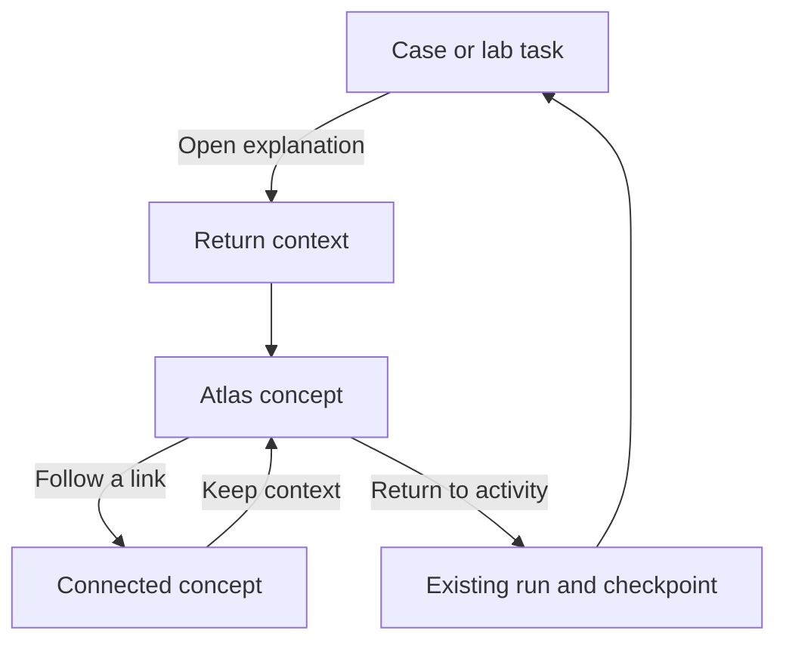

# Task 03.1 — Four learning destinations and route plan

Prepared for Raj Ranjan, 13 October 2026. Design complete. Runtime implementation belongs to Tasks 03.2 and 03.3. Baseline: FinanceMap draft commit ea219af22a3c81dbe8fe25dcd497cc03125c6a05.

## 1. Four destinations

Use Atlas, Labs, Simulations and My learning as the four persistent primary destinations. Keep global concept search. Keep Sources & master documents accessible from Atlas navigation and the global footer.

| Destination | Learner-facing description | Main action | Scope |
| --- | --- | --- | --- |
| Atlas | Understand a finance concept and follow its connections. | Explore a statement, topic or connection. | All 698 concepts, 40 areas, statement explorer, detailed lessons, maps, reading trails and reference documents. |
| Labs | Change one assumption and see what happens. | Predict, experiment and explain a mechanism. | The three agreed labs: customer collection, equipment investment and financing comparison. These remain planned until Chunk 07 builds and verifies them. |
| Simulations | Run a company through connected finance decisions. | Start or resume a case. | The current three-clue P02 mystery and, later, the six-round Nila Homeware company case. |
| My learning | Resume your work and review your answers. | Continue an unfinished activity. | Saved concepts, exploration, first/latest responses, completed cases and later targeted review. Session-only until validated local storage is implemented in 05.2. |

Reading trails belong in Atlas because visiting their stops is guided study. The playable mystery belongs in Simulations because it requires answers and an explicit Finish. Do not treat a visited trail as a solved case.

Preserve all 24 master journey IDs and their exact ordered nodes. P02 has an eight-stop reference sequence in the master inventory, while its playable mystery has three clues. Distinguish activity kinds trail and simulation when they share a master ID. Do not call the eight-stop sequence eight playable rounds.

The lab selection follows Task 01.3’s Release scope sheet, which explicitly supersedes the preliminary grouping in Task 01.2. Working-capital forecasting and full-company DCF stay in the shared company case. No fourth lab is added.

## 2. Navigation and screen hierarchy

Desktop header: brand, concept search, Atlas, Labs, Simulations and My learning. Mark the active destination visually and accessibly. The brand opens the Atlas overview. Sources & master documents stays visible in Atlas navigation and the global footer.

On small screens, use a labelled navigation menu with the same four names. Keep search and an active Return action reachable without horizontal scrolling. Task 03.3 prototypes and verifies the detailed responsive layout, keyboard focus and scrolling.

| Screen | Primary area | Supporting area | Next or return action |
| --- | --- | --- | --- |
| Atlas overview | Statements, all topics, connections and reading trails | Search and sources | Open a concept or choose an applied activity. |
| Statement explorer | Statement and selectable line items | Hover definition and full concept lesson | Trace a statement effect, follow connections or return to an activity. |
| Full concept lesson | Explanation, types, worked examples and topic quiz | Financial links, learning links and applicable activity links | Read deeper, practise or return to the exact originating activity. |
| Connection map | Selected concept and neighbours | Accessible text list with direction, type, reason and conditions | Open a related concept while keeping return context. |
| Lab workspace | Prediction, inputs and observable effects | Explanation on demand | Commit a response, inspect the effect or return from a concept. |
| Simulation workspace | Current clue or period and its decision | Case facts, hint/explanation entry and financial views | Continue or Finish explicitly. Reading does not advance a period. |
| My learning | Unfinished activities and one next action | Saved concepts and answer history | Resume an existing run or explicitly start another. |

Detailed Atlas lessons retain their expanded default. Hover definitions remain short summaries. Task 03.3 introduces the focused activity layout and wider lesson view, with a review of presentation changes before applying them widely.

## 3. Proposed routes

Retain hash routing for GitHub Pages. These routes are a design specification, not working public links yet. IDs stay case-sensitive, including dots such as T06.02. Validate identifiers against the inventory.

| Proposed hash route | Screen | Route-owned state |
| --- | --- | --- |
| #atlas | Reference overview | None. |
| #atlas/statements/{statement}/{conceptId} | Statement explorer | balance, income or cash, and selected concept. |
| #atlas/topics/{conceptId} | Topic catalogue and selected lesson | Optional validated query, area, depth and practice filters. |
| #atlas/map/{conceptId} | Concept connections | Optional scope, relationship filter and learning-link inclusion. |
| #atlas/lessons/{conceptId} | Wider full lesson | Optional section and return-context token. |
| #atlas/trails/{journeyId}?stop={index} | Reading trail | Existing journey ID and a bounded zero-based stop. |
| #atlas/sources/{conceptId} | Sources and downloads | Contextual concept, when supplied. |
| #labs | Lab catalogue | Availability and prerequisites. |
| #labs/{labId} | Lab brief | Activity ID; no run is created. |
| #labs/{labId}?run={runId} | Existing lab run | Resolve current checkpoint from the record. |
| #simulations | Case catalogue | Optional selected-concept context from a legacy entry. |
| #simulations/{caseId} | Case brief | Activity ID; no run is created. |
| #simulations/{caseId}?run={runId} | Existing case run | Resolve current clue/period and choices from the record. |
| #learning | Learning record | Unfinished activities and record views. |

Proposed lab activity IDs: LAB-COLLECTIONS, LAB-EQUIPMENT and LAB-FINANCING. The current mystery keeps P02. The proposed longer-case activity ID is CASE-NILA-HOMEWARE, so completing the mystery cannot count as completing the six-round simulation. Its learning links can refer to the existing P02 curriculum without renaming it.

Activity IDs are separate from concept IDs. Task 05.1 finalises scenario/run versions before persistence. Query parameters select a screen or refer to an existing record. They never carry an answer key, a trusted score, authoritative balances or a completion flag. A URL alone cannot manufacture saved progress. Use one validated route parser and encoder.

## 4. Map every current entry point

The current app accepts six view names. Retain all six as compatibility aliases when implementing the new router. Normalise with replaceState so Back does not visit two spellings of the same screen.

| Current route or action | Proposed home | Preservation rule |
| --- | --- | --- |
| #statements/{conceptId} | #atlas/statements/balance/{conceptId} | Old URL does not encode a statement tab. Default to balance on a fresh visit. Preserve the in-session tab through its navigation snapshot. |
| #map/{conceptId} | #atlas/map/{conceptId} | Keep selected ID, direction and relationship meaning. |
| #topics/{conceptId} | #atlas/topics/{conceptId} | Keep selected ID and in-session filters. |
| #missions/{conceptId} | #simulations?concept={conceptId} | Old suffix is a concept ID, not a case/run ID. Open the catalogue with an Atlas reading-trails link. Never silently start or replay. |
| #learning/{conceptId} | #learning?concept={conceptId} | Preserve contextual concept while showing the learning record. |
| #resources/{conceptId} | #atlas/sources/{conceptId} | Keep original download paths and external source links. |
| Statement line items, hover and statement tabs | Atlas statements or concept | Keep line-item IDs and selected statement. Hover gives a short definition; click opens depth. |
| Global search, domain selection and catalogue filters | Atlas lesson, map or catalogue | Domain IDs select an area filter rather than a nonexistent concept lesson. |
| Relationship links, Next connected topic question and Surprise me | Atlas concept or map | Preserve labels, reasons, conditions and connection-first question selection. |
| Current non-P02 mission cards and stop controls | Atlas trails | Keep each journey ID and exact ordered nodes. |
| Investigate the case / Try a finance mystery | P02 brief, then explicit Start or Resume | Start creates a run only when selected. Resume restores an existing run. |
| Follow cash into valuation after completion | Atlas A11 with return context | Return opens that finished run’s debrief, without restarting it. |
| Saved concept, exploration trail and answer review | Atlas concept with learning return context | Reading does not submit an answer or finish a case. |
| Brand and footer | Atlas overview, topics and sources | All four primary destinations remain reachable. |
| PDF/XLSX downloads and external further reading | Same existing URLs | Preserve downloads and external links; open external reading separately. |

The bare website address remains a usable entry. Task 03.2 adds guided and free-exploration choices. Invalid identifiers receive a recovery action; they do not create curriculum IDs or new activities.

## 5. Return to an unfinished activity

Keep activity state outside the lesson component. A lesson detour must not call the current startJourney transition because it creates a fresh P02 run. Introduce a separate resume/open-existing-run transition during implementation.

Store a validated return context in session state. A route carries only its token.

| Context field | Purpose |
| --- | --- |
| token | Reference a known context without embedding answers. |
| activityKind and activityId | Distinguish simulation, lab and reference trail. |
| runId and scenarioVersion | Return to the same play and compatible scenario. |
| checkpoint | Current clue/period and selected task. |
| originRoute and viewportSnapshot | Restore statement, tab, filters and useful reading position. |
| hintState | Preserve whether the active clue used an answer-revealing lesson. |

The run owns selections, submitted responses, inputs, financial state and completion. A context checkpoint is a navigation snapshot, not a second ledger. If the run has moved on, return to its current valid checkpoint rather than replaying a stale snapshot.

Example: a learner answers P02 clue 1 incorrectly, opens working capital A05, follows a link to receivables A02, then selects Return to cash mystery, clue 1 of 3. Restore the same run, wrong current choice, immutable first response, hint record and explanation. No clue advances and no new run is added. Correcting and explicitly continuing then moves to clue 2.

Before an unanswered clue’s full explanation opens, offer Open lesson as a hint. Commit hint use for that clue before navigation. Lesson-opening through search or other internal entry points from an active unanswered task uses the same explicit opt-in gate. Keep trying stays in the task. Merely opening navigation, searching titles or hovering does not mark a hint. Reading does not mark an answer correct or finish a case.

Show Return to [activity], [checkpoint] on the lesson and connected concepts. Carry the context through concept links and map exploration until return or explicit dismissal. Do not force unrelated later Atlas visits to return to an old run. When several runs exist, use the originating run; My learning lists the others separately.

| Situation | Planned behaviour |
| --- | --- |
| Back / Forward during a lesson detour | Restore route and valid context without submission, period advancement or run creation. |
| Switch top-level destination | Keep the run intact and resumable from My learning. |
| Return to a finished run | Open its debrief. Replay is a separate explicit action. |
| Missing return token or run | Explain that the activity is not available in this session. Open its brief and offer an explicit new start. |
| Refresh or close before 05.2 | Explain session reset. Make no cross-session resume promise. |
| Refresh after 05.2 | Validate local-save version before resuming; unsupported/corrupt data uses the recovery flow. |
| Link to a planned lab or longer case | Show availability or its brief, with no playable claim until implementation passes. |
| External source reading | Open separately and retain the internal run/context. |

## 6. Preserve the finance web

Do not rename concept IDs, anchor aliases, domains or journeys. Do not reorder journey nodes or modify relationship records to fit four tabs. The navigation layer references the current inventory.

Keep the current learning/navigation relationship types: PART_OF, EXPLORE_WITH, RECOMMENDED_BEFORE and DEEPENS. Keep all other authored financial/contextual links with direction, reason and conditions. A displayed relationship is not automatically a numerical dependency; Chunk 06 separately specifies the verified mechanisms the simulation calculates.

Trails and lab/case associations are learning metadata. They can share concept references without becoming calculated financial edges. Retain the accessible textual relationship list beside the map.

## 7. Implementation order

| Task | Handoff |
| --- | --- |
| 03.1 | Four descriptions, route catalogue, six compatibility mappings, entry-point inventory and return contract. |
| 03.2 | Implement destination entry, guided/free-exploration choices, P02 objective/prerequisites/estimated length and session resume. Label estimates until pilot verification. |
| 03.3 | Focused workspace, wider lesson, breadcrumbs and Return action. Verify browser history, state retention, keyboard, desktop and mobile. |
| 05.1–05.2 | Finalise scenario/run save versions, validate import/storage and enable cross-session resume. |
| 07 and 08 | Enable the agreed three labs and longer case after calculation and content verification. |

task-03-1-routes.json is a machine-readable planning inventory, not an app import. Its trail entries reference the original master sequences rather than duplicating or replacing them. Do not advertise proposed routes as working links before implementation.

## 8. Acceptance walkthroughs for implementation

1. Open all six old hashes with A02 and T06.02. Preserve the selected concept and intended destination. A missions alias opens a catalogue without starting a run.
2. Resolve all 698 concept IDs and every domain filter. Traverse a financial and a learning link, checking direction and labels.
3. Open all P01–P24 trails and check exact master node order. Distinguish P02’s eight-stop reference trail from its three playable clues.
4. Answer P02 incorrectly, detour A05 to A02 and Return. Check run identity, clue, current choice, first response, hint state and completion count. Repeat before answering, with deliberate hint opt-in.
5. Continue to clue 2, detour again, then use Back/Forward. No extra response, new run, skipped clue or duplicate completion may appear.
6. Leave an unfinished activity for My learning and Resume. Compare with explicit Replay after completion, which creates a fresh run while keeping history.
7. Open a lesson from a finished run and Return to its debrief. Refresh a session-only route and verify the honest recovery message.
8. Try unknown concepts, unavailable activities and missing run tokens. Recover without silently creating progress.
9. On a narrow screen and with a keyboard, find all four destinations, Sources, search, full lesson and Return. Verify focus and scrolling in 03.3.

## 9. Verification and limits

Design inventory checks passed against the latest draft source: four destinations, all six existing view names, 698 stable concepts, 40 domains, 24 journey IDs and their exact source sequences, and 2,520 relationship records. The initial route inventory was checked in the isolated checkout before its connection became unavailable; the final planning inventory keeps the trail sequences by authoritative source reference.

Only documentation and planned-navigation instructions change in this task. Runtime code, hosting files and curriculum records are unchanged. No build or runtime test is claimed for a documentation-only change. Browser route/resume behaviour is specified for verification in 03.2–03.3, not reported as implemented.

The task tracker workbook update remains pending because the local execution connection became unavailable during the update. Its latest verified version is 3, with 02.3 complete and 03.1 ready. On recovery, mark Backlog row 16 Done with this document/PR as evidence, preserve all formulas and native features, recalculate, and confirm 03.2 becomes Ready.

### Source records

- FinanceMap commit ea219af22a3c81dbe8fe25dcd497cc03125c6a05: src/App.jsx, src/learning-session.js, src/CashMystery.jsx, content/master-network.json and AGENTS.md.
- Finance Atlas Implementation Roadmap, Chunk 03, page 6, current document read on 13 October 2026.
- Task 01.2 learner/outcomes specification, and Task 01.3 first-release backlog, Release scope rows 13–16. The backlog’s lab reconciliation takes precedence over preliminary lab grouping.

Next: 03.2 — Add a guided entry and activity brief.
